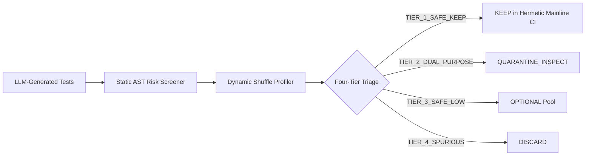

# Replication Package — Why Do LLM-Generated Unit Tests Fail to Enter Continuous Integration?

[](LICENSE)
[](https://www.python.org/)
[](https://github.com/forgemorrow/llm-test-generation-quarantine/actions/workflows/ci.yml)

Artifact for the empirical study manuscript:

> **Why Do LLM-Generated Unit Tests Fail to Enter Continuous Integration? A Multi-Stage Empirical Study on SWE-bench Verified**
> Chaoyi Zhu, Yawen Yu, Hengyue Zhang — Qilu Normal University — submitted to *Journal of Systems and Software*

This repository contains the complete multi-stage empirical study dataset (`results/empirical_study_20261118/`), portable audit/analysis/figure/table scripts (`scripts/empirical_study_20261118/`), zero-leakage prompts, generated test suites across four open-weight LLMs (`Qwen3-8B`, `Qwen2.5-7B`, `DeepSeek-Coder-6.7B`, `CodeLlama-7B`), socket-guard instrumentation (`HERMETIC_CI=1`), and archived baseline artifacts.

## Multi-Stage Empirical Study Artifacts (`empirical_study_20261118`)

- **`results/empirical_study_20261118/`**: Raw audit outputs and verified summary metrics backing Tables 1–6 and Figures 1–4 of the manuscript:
  - `empirical_funnel_audit.json` — Gate 1–5 per-file and per-test execution records across Core-13 (4 models) and All-17 (`Qwen3-8B`).
  - `step1_gap_closure.json` — `-W ignore --tb=short` collection tracebacks, per-test open-network timeout resolutions, $N=20$ hermetic shuffle runs (15,500 executions), $N=10$ open-network shuffle runs (1,300 executions), and `Minimal-200` / `HTTP-Echo` mock remediation logs.
  - `static_oracles_summary.json` — Static oracle metrics and function- vs. class/module-scope AST URL screening accuracy.
  - `empirical_master_metrics.json` — Aggregated counts, 95% Wilson CIs, and paired Friedman/Holm-Wilcoxon statistics.
  - `SHA256_MANIFEST.txt` — Byte-exact SHA-256 checksums for all 6 scripts and 4 JSON artifacts.
- **`scripts/empirical_study_20261118/`**:
  - `run_empirical_funnel_audit.py`, `run_step1_gap_closure.py` — End-to-end Ephemeral Git worktree audit drivers (require `data/repos/` checkouts at the pinned commits).
  - `analyze_static_oracles.py`, `analyze_step1_complete.py` — Recompute `static_oracles_summary.json` and `empirical_master_metrics.json` directly from raw JSONs and `data/`.
  - `generate_empirical_figures.py`, `generate_empirical_tables.py` — Regenerate all 4 vector figures (`.pdf`/`.png`) and 6 `elsarticle` LaTeX tables.

### Reproduce All Summary Metrics, Tables, and Figures (Offline)

```bash
pip install pytest requests numpy scipy matplotlib
python scripts/empirical_study_20261118/analyze_static_oracles.py
python scripts/empirical_study_20261118/analyze_step1_complete.py
python scripts/empirical_study_20261118/generate_empirical_figures.py
python scripts/empirical_study_20261118/generate_empirical_tables.py
```

Custom output directories can be specified via `EMPIRICAL_FIGURES_OUT` and `EMPIRICAL_TABLES_OUT`.

## Pipeline Overview



## Quick Verification

Run the offline verification suite without cloning the excluded 520 MB upstream repositories (tests gated on `data/repos/` skip automatically):

```bash
pip install pytest requests
python -m compileall -q src tests
pytest tests/ -v
```

For full SWE-bench replication steps and checksum verification, see [REPLICATION.md](REPLICATION.md) and [PACKAGE_CONTENTS.md](PACKAGE_CONTENTS.md).

## What is here

| Path | Contents |
|---|---|
| `src/` | AST feature extraction, shuffle profiling, four-tier triage, socket guard |
| `scripts/` | Experiment drivers, cross-model benchmark, plotting, audit utilities |
| `prompts/` | Zero-leakage test-generation prompt templates |
| `configs/` | Experiment configuration |
| `tests/` | Unit and integration tests |
| `results/` | Formal run archive, incl. `runs/run_phase4_rerun_20260926_090500/` |
| `data/` | Benchmark fixtures, generated tests, cross-model outputs |
| `REPLICATION.md` | Step-by-step reproduction instructions |
| `PACKAGE_CONTENTS.md` | Provenance notes (manifest coverage, excluded upstream repos) |
| `DEV_README.md` | Original development README of the working project |

## Formal run

`results/runs/run_phase4_rerun_20260926_090500/` is the authoritative run. Its
`manifest.json` records SHA-256 digests for **363 files**. The directory contains
**366 files**: the 363 hashed files plus `manifest.json` itself and
`evidence_audit.json` / `evidence_audit.md`, which were produced after hashing.
Manifest paths use Windows separators, matching the machine the run executed on.

## Upstream repositories

`data/repos/` is intentionally not bundled (≈520 MB of public clones). The exact
commits used are recorded in `data/repos_state_audit.json` and listed in
`PACKAGE_CONTENTS.md`; re-clone them at those commits to reproduce the runs.

## Environment

Python 3.11 with pytest, plus a local Ollama deployment of `qwen3:8b`
(temperature 0.7, `num_predict` 4096). Model artefacts are pinned by configuration
digest in the manuscript (Section 4.3 and Section 5.9). The Ollama runtime version
was not fixed at experiment time and is therefore not reported.

## Citation

See `CITATION.cff`. If you use this artifact, please cite the manuscript and the
archived release DOI.

## License

MIT — see `LICENSE`.
