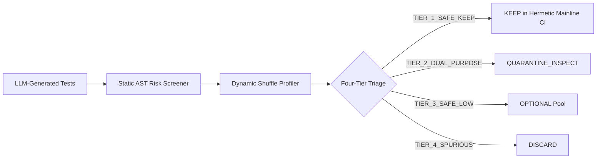

# Replication Package — Quarantining Environmentally Fragile LLM-Generated Tests

[](LICENSE)
[](https://www.python.org/)
[](https://github.com/forgemorrow/llm-test-generation-quarantine/actions/workflows/ci.yml)

Artifact for the manuscript:

> **Quarantining Environmentally Fragile LLM-Generated Tests: A Project-Level Empirical Study on SWE-bench Verified**
> Chaoyi Zhu, Qilu Normal University — submitted to *Journal of Systems and Software*

This repository contains everything needed to inspect and re-run the study: the static AST risk screener, the dynamic shuffle profiler, the four-tier triage implementation, the socket-guard instrumentation used for hermetic CI, all experiment drivers, and the archived formal run.

## Pipeline Overview



## Quick Verification

Run the offline verification suite without cloning the excluded 520 MB upstream repositories (tests gated on `data/repos/` skip automatically):

```bash
pip install pytest requests
python -m compileall -q src tests
pytest tests/ -v
```

For full SWE-bench replication steps and checksum verification, see [REPLICATION.md](REPLICATION.md) and [PACKAGE_CONTENTS.md](PACKAGE_CONTENTS.md).

## What is here

| Path | Contents |
|---|---|
| `src/` | AST feature extraction, shuffle profiling, four-tier triage, socket guard |
| `scripts/` | Experiment drivers, cross-model benchmark, plotting, audit utilities |
| `prompts/` | Zero-leakage test-generation prompt templates |
| `configs/` | Experiment configuration |
| `tests/` | Unit and integration tests |
| `results/` | Formal run archive, incl. `runs/run_phase4_rerun_20260926_090500/` |
| `data/` | Benchmark fixtures, generated tests, cross-model outputs |
| `REPLICATION.md` | Step-by-step reproduction instructions |
| `PACKAGE_CONTENTS.md` | Provenance notes (manifest coverage, excluded upstream repos) |
| `DEV_README.md` | Original development README of the working project |

## Formal run

`results/runs/run_phase4_rerun_20260926_090500/` is the authoritative run. Its
`manifest.json` records SHA-256 digests for **363 files**. The directory contains
**366 files**: the 363 hashed files plus `manifest.json` itself and
`evidence_audit.json` / `evidence_audit.md`, which were produced after hashing.
Manifest paths use Windows separators, matching the machine the run executed on.

## Upstream repositories

`data/repos/` is intentionally not bundled (≈520 MB of public clones). The exact
commits used are recorded in `data/repos_state_audit.json` and listed in
`PACKAGE_CONTENTS.md`; re-clone them at those commits to reproduce the runs.

## Environment

Python 3.11 with pytest, plus a local Ollama deployment of `qwen3:8b`
(temperature 0.7, `num_predict` 4096). Model artefacts are pinned by configuration
digest in the manuscript (Section 4.3 and Section 5.9). The Ollama runtime version
was not fixed at experiment time and is therefore not reported.

## Citation

See `CITATION.cff`. If you use this artifact, please cite the manuscript and the
archived release DOI.

## License

MIT — see `LICENSE`.
